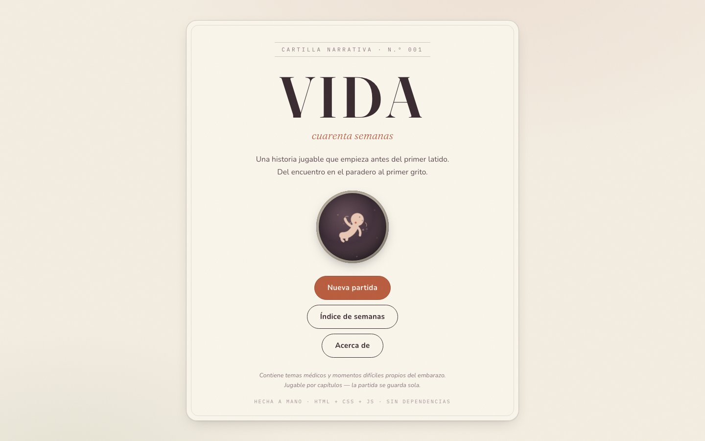
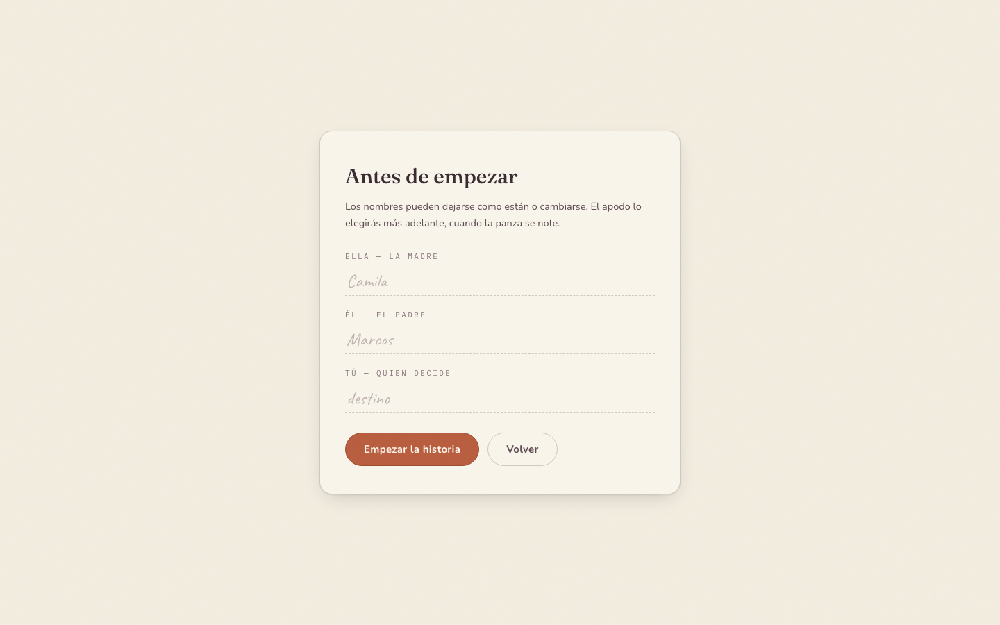
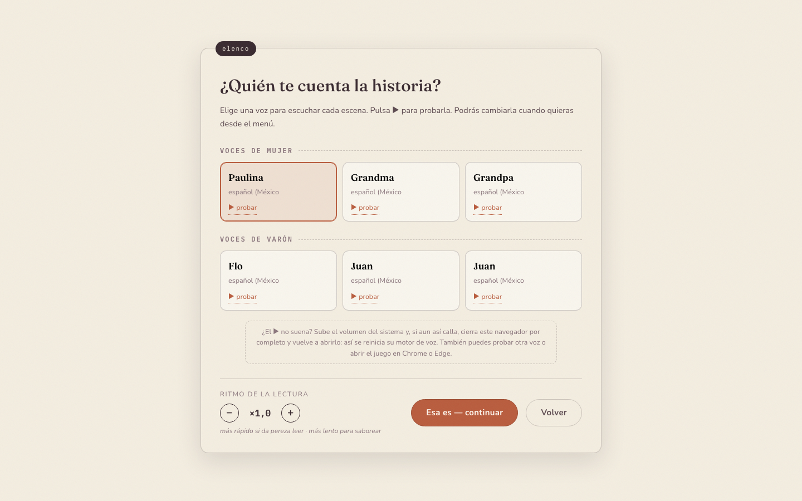

# VIDA · cuarenta semanas

Una novela visual jugable sobre toda la gestación: desde que dos personas se
conocen en un paradero de Pamplona Alta (Lima) hasta el primer grito. Juegas
como la conciencia de quien aún no nace — y, según avanzas, esa conciencia
empieza a notar que alguien está decidiendo por ella. Tú.

## Galería

<table>
<tr>
<td align="center" valign="top"><br><sub>Portada narrativa</sub></td>
<td align="center" valign="top"><br><sub>Configuración de una partida</sub></td>
</tr>
<tr>
<td align="center" valign="top"><br><sub>Escena de la historia</sub></td>
</tr>
</table>

## Cómo jugar

Abre `index.html` en cualquier navegador moderno (doble clic basta; no hay
servidor, dependencias ni instalación). Para jugar en el celular en red local:

```bash
python3 -m http.server 8000 --directory ~/vida
# y abre http://TU-IP:8000 en el teléfono
```

- **A / B / C / D** o **1–4** eligen decisión · **Espacio** avanza o completa el texto
  · **← / →** retroceden o avanzan una escena entera (deshace la última decisión;
  solo se puede avanzar hacia escenas que ya ocurrieron).
- La partida **se guarda sola** tras cada decisión. Puedes jugar por capítulos,
  una semana al día.
- **Narradores con voz**: al empezar eliges entre 3 voces de mujer y 3 de varón
  latinoamericanas (las que tu navegador tenga instaladas). El narrador lee
  cada escena como un cuentacuentos; puedes acelerar o ralentizar la lectura
  (botón 🔊 del HUD o menú → «Voz del narrador») si da pereza leer, y pausarla
  al instante con el botón ⏸ del HUD. En los diálogos, cada personaje tiene su
  propia voz y subtítulos en color.
- Cada escena muestra su **escenario dibujado**: paradero, baño del pasaje,
  posta, azotea, obra, escaleras, hospital… para ubicarse de un vistazo.
- El botón ♪ activa el latido fetal sintetizado (tempo real según semana).
- Las **escenas sonoras** generan el ambiente con WebAudio: calle con bocinas,
  sala de posta con pitidos, sismo, cumbia lejana, puertas, guitarra… y el
  primer llanto al final.
- El botón ☰ permite copiar/pegar la partida como código para continuarla
  en otro dispositivo.

## Qué contiene

| | |
|---|---|
| 66 capítulos | prólogo (el encuentro), semanas 1–40, parto ramificado |
| 108 decisiones | A/B/C/D, con opciones que se **desbloquean** según lo vivido |
| 10 minijuegos | la carrera de millones, el latido, las patadas, ecografías a raspa, reconocer voces, armar la maleta, respiración de parto, nuestra canción, señales de alarma — los sonoros tienen su botón ▶ para escuchar cuando tú quieras |
| 8 escenas sonoras | diálogos con voces propias: la combi, las dos rayitas, la posta, el terremoto, la azotea, la pelea, el taxi… y la sala donde se oye el primer grito |
| 7 finales | del parto perfecto a la UCIN, cesárea, nacer en camino… y uno más |
| Simulación de conciencia | 5 umbrales de despertar: LA VOZ recuerda tus decisiones y te habla |
| Realismo obstétrico | tamaños, pesos, latidos y pruebas médicas reales semana a semana |

Las decisiones malas no son game over inmediato: se acumulan en cuatro
medidores (salud, vínculo, desarrollo, conciencia) y definen qué crisis te
encuentras y cómo termina. Si la salud colapsa hay retroceso al último control.

## Estructura

```
vida/
├── index.html              pantallas del juego
├── css/styles.css          diseño completo (cartilla prenatal)
├── js/
│   ├── engine.js           motor: grafo, stats, flags, guardado, finales
│   ├── ui.js               máquina de escribir, decisiones, minijuegos
│   ├── narrador.js         voces del sistema (TTS): elenco, velocidad, colas
│   ├── escenas.js          el cuadrito del escenario: viñetas SVG por lugar
│   ├── conciencia.js       LA VOZ: despertares, recuerdos, carta final
│   ├── feto.js             ventana semanal al útero (SVG + datos reales)
│   ├── audio.js            latido + ambientes WebAudio sin archivos
│   └── data/               TODO EL CONTENIDO NARRATIVO:
│       ├── prologo.js      el encuentro y la concepción (+ combi sonora)
│       ├── t1.js           semanas 1–12 (+ baño y posta sonoros)
│       ├── t2.js           semanas 13–27 (+ terremoto, azotea, pelea, canción)
│       ├── t3.js           semanas 28–40 (+ quiz de alarmas, taxi sonoro)
│       └── parto.js        parto, sala del primer grito, finales F1–F7
└── herramientas/
    ├── validar.mjs         valida el grafo (enlaces, flags, tokens)
    └── simular.mjs         juega partidas completas con el motor real
```

## Ampliar la historia

Cada capítulo es un objeto registrado en `VIDA.motor.registrar([...])`:

```js
{
  id: "s13", sem: 13, temp: "Segundo trimestre",
  lugar: "El cuarto · mañana", titulo: "Título de la semana",
  eco: ["Párrafo narrativo.", "Otro párrafo."],
  opciones: [
    { t: "Decisión A", ef: { salud: 3 }, fl: ["mi-flag"],
      nota: "Consecuencia visible tras elegir.",
      req: { fl: ["flag-previa"] },          // ← así se BLOQUEA/desbloquea
      pista: "Necesita haber cantado antes",
      sig: "s14" }                           // opcional: si falta, sigue lineal
  ],
  diario: { fecha: "...", texto: "...", autor: "{mama}" },
  sig: "s14"
}
```

Tokens disponibles en cualquier texto: `{mama}` `{papa}` `{bebe}` `{jugador}`.

También existe el nodo **sonoro** (escena que se escucha):

```js
{
  id: "snXX", sem: 20, temp: "Segundo trimestre", tipo: "sonoro",
  lugar: "…", titulo: "…", consigna: "(escena sonora — …)",
  ambiente: ["calle"],                       // o función (estado) => ["cumbia"]
  dialogos: [ { quien: "mama", texto: "…" } ], // o función (estado) => [...]
  golpes: [{ en: 2, sfx: "puerta" }],        // sfx: puerta | llanto | guitarra
  sig: "sXX"
}
```

`quien` admite: mama, papa, doctora, enfermera, comadre, vecina, chofer, voz,
narrador — cada uno recibe voz propia del elenco TTS y color de subtítulo.
Si `dialogos`/`ambiente`/`golpes` son funciones reciben `estado` y pueden
ramificar según flags.

Después de ampliar, corre siempre:

```bash
node herramientas/validar.mjs     # grafo íntegro
node herramientas/simular.mjs 100 # cien partidas automáticas
```

## Notas

- Los datos médicos (tamaños comparativos, latidos por semana, hitos) siguen
  referencias obstétricas estándar; los personajes y el barrio son ficción.
- La historia incluye sangrado, sismo, pérdidas económicas y, por malos
  caminos, una pérdida gestacional tratada con respeto. Hay aviso en portada.
- Hecho a mano en HTML/CSS/JS. Sin frameworks, sin build, sin rastreo.
